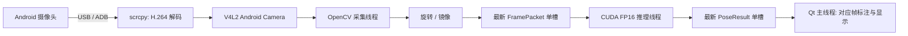

# 架构与生命周期

[返回 README](../README.md) · [Python API](PYTHON_API.md)

## 数据路径

scrcpy 直接采集手机摄像头，不需要打开手机相机界面或截取屏幕。生产者请求 H.264、720p / 30 FPS、4 Mbit/s，关闭音频、手机控制与 scrcpy 播放窗口。视频经 V4L2 输出，Python 通过 OpenCV 的 V4L2 后端读取 BGR 图像。

`exclusive_caps=1` 让虚拟设备在没有写入端时呈现输出能力，有生产者后呈现采集能力。启动流程据此判断流是否就绪或已有生产者。摄像头准备脚本优先使用空闲 `/dev/video10`，实际编号由系统状态决定。

## 线程与帧对应关系

| 执行位置 | 工作 |
| --- | --- |
| Qt 主线程 | 控件交互、约 33 ms 定时读取最新结果、标注和绘图 |
| 设备发现线程 | ADB 设备查询，结果由 GUI 定时接收，避免阻塞窗口 |
| Pipeline 推理线程 | CUDA 检查、下载 / 加载 / 预热、流启动、串行推理和状态监测 |
| FrameSource 采集线程 | 打开设备、持续读取、统一变换图像、发布最新帧、释放设备 |
| scrcpy 子进程 | 手机上的摄像头服务、USB 视频传输、解码与虚拟设备输出 |

采集与推理之间、推理与 GUI 之间各有一个 `LatestValue` 单槽。新值覆盖旧值，消费者带上上一发布序号读取更新；慢推理会跳过旧帧，而不会形成应用层的无限排队。驱动和 USB 等下游 / 上游缓冲仍可能影响实际延迟。

每个 `PoseResult` 携带它对应的 `FramePacket`。渲染从该结果的图像创建副本，再绘制框与骨架；不拿采集线程的另一张最新帧叠加旧结果。旋转先执行，镜像随后执行，都在推理前完成，坐标、骨架和画面因此使用同一个空间。

Qt 的图像由 BGR 转换成 RGB 后拷贝，避免复用 NumPy 内存造成显示内容失效。主线程不会执行模型下载、摄像头阻塞读取或 YOLO 推理。

## 模块职责

| 文件 | 职责 |
| --- | --- |
| `backend.py` | 查找系统工具、筛选 USB ADB 手机、Android API 检查、V4L2 能力查询与 scrcpy 所有权 |
| `capture.py` | 最新值缓冲、FramePacket、图像变换与 OpenCV 采集线程 |
| `pose.py` | 官方模型下载 / 校验、CUDA 预热、PoseResult、COCO 名称和骨架连接 |
| `pipeline.py` | 一个完整采集 / 推理会话，启动、取消、错误传播和清理 |
| `render.py` | 在结果对应帧的副本上绘制人体框、点和骨架 |
| `gui.py` | PySide6 控件、异步启停、状态呈现和定时绘图 |
| `cli.py` | doctor、camera、gui、benchmark 命令及统计报告 |
| `paths.py` | 本地工具、状态、模型缓存目录与 Ultralytics 配置 |

## 启动、停止与故障

拥有生产者的正常会话：

1. 启动 Pipeline 工作线程，检查 CUDA，加载并预热模型，确认推理后端是 CUDA / FP16。
2. 选择已授权的 USB 手机，确认 Android API ≥31，找到可读写的 Android Camera 设备。
3. 确认设备没有已有视频生产者，再启动自己的 scrcpy，等待采集能力就绪。
4. 启动 FrameSource，持续读取最新帧进行串行推理；更新最新结果。
5. 每轮检查自己的生产者和采集错误，并周期检查设备能力；超过 5 秒没有新帧时报错。

停止时设置取消事件，先让采集线程退出并释放 OpenCV 设备，再停止自己拥有的 scrcpy。这个顺序保持写入端存活，以便正常停止时最后一次读取能够返回。scrcpy 在独立进程组中启动；先发送 SIGTERM，超时后才强制结束该进程组。

GUI 的停止 / 关闭不会在回调中同步等待推理；定时检查后台是否完成，然后更新控件或关闭窗口。断线、摄像头占用或下载失败会记录明确错误，资源清理后可创建新会话重试。异常 V4L2 读取可能需要等待驱动超时，因此关闭不一定瞬间完成。

已有流模式只检查指定设备已有采集能力，不启动 scrcpy，也不停止外部生产者。独立 `camera` 命令与 GUI 拥有的子进程相互独立。不要通过结束所有 scrcpy 的方式清理单个应用会话。

## 模型与 GPU

torch 和 torchvision 固定版本，通过显式的 `pytorch-cu126` uv 索引绑定。Ultralytics 使用官方 headless 变体，避免 GUI OpenCV 与 Qt 平台插件互相影响。默认模型为 `yolo26n-pose.pt`，较大模型为 `yolo26s-pose.pt`，内置权重来自固定官方 release 并校验固定 SHA-256。

`PoseRunner` 只接受具有 `(17,3)` 关键点定义的 Pose 模型。推理使用 GPU 0、FP16 和 `imgsz=640`；固定 Ultralytics 版本中通过 `quantize="fp16"` 配置精度。检查实际 predictor 后端的设备和 FP16 状态，而不是只看最初创建的模型对象。

CPU 返回的人体框与关键点已对应输入图像像素。`inference_ms` 包含预处理、GPU 推理和结果拷回 CPU；GPU 的相关工作在结果转到 CPU 时完成同步。GUI 的显存和 benchmark 的峰值来自 PyTorch 分配器，不包含驱动上下文或其他程序的显存。

## 文件与数据边界

仓库默认根目录由源码位置确定。可在导入包前使用 `REMOTE_CAMERA_HOME` 指定另一个已存在的可写根目录；程序按它查找 `.tools/`、`weights/` 与 `.state/`。安装脚本则始终安装到脚本所在仓库，不会自动迁移到该环境变量目录。

帧和关键点仅在内存流转。模型首次下载和安装依赖需要网络，运行代码没有上传图像或关键点的步骤。`.state/` 保存 scrcpy 文本日志和 Ultralytics 设置；benchmark 只在指定 `--report` 时写统计文件。验证截图是开发验证时显式生成的本机资料，未提交公开仓库。

日志与 doctor 输出可能包含手机序列号或本机路径。它们不含视频数据，但分享前仍需脱敏。源码、文档、测试和 uv 锁文件进入 Git；环境、工具二进制、权重与运行资料不进入 Git。
